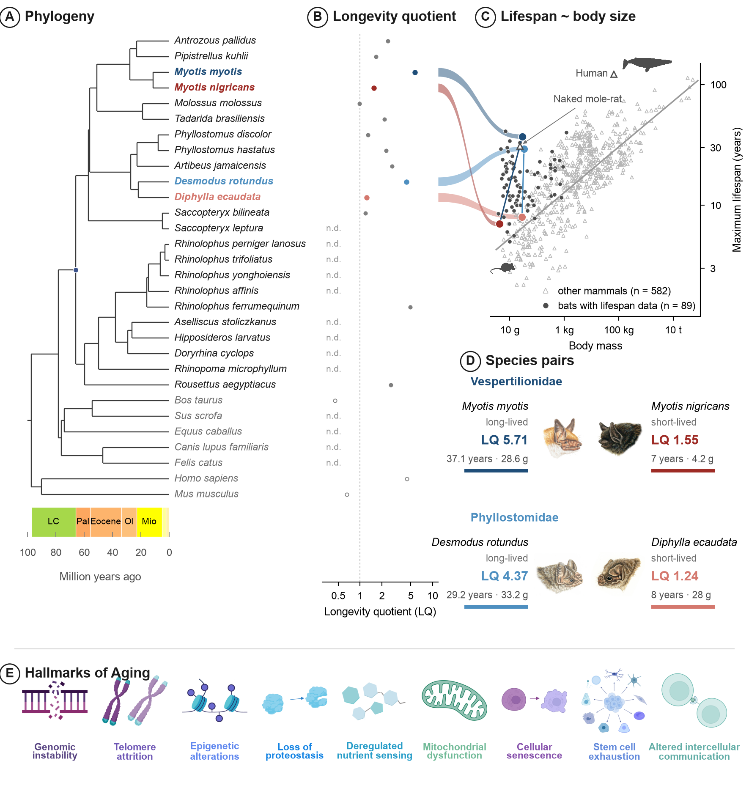
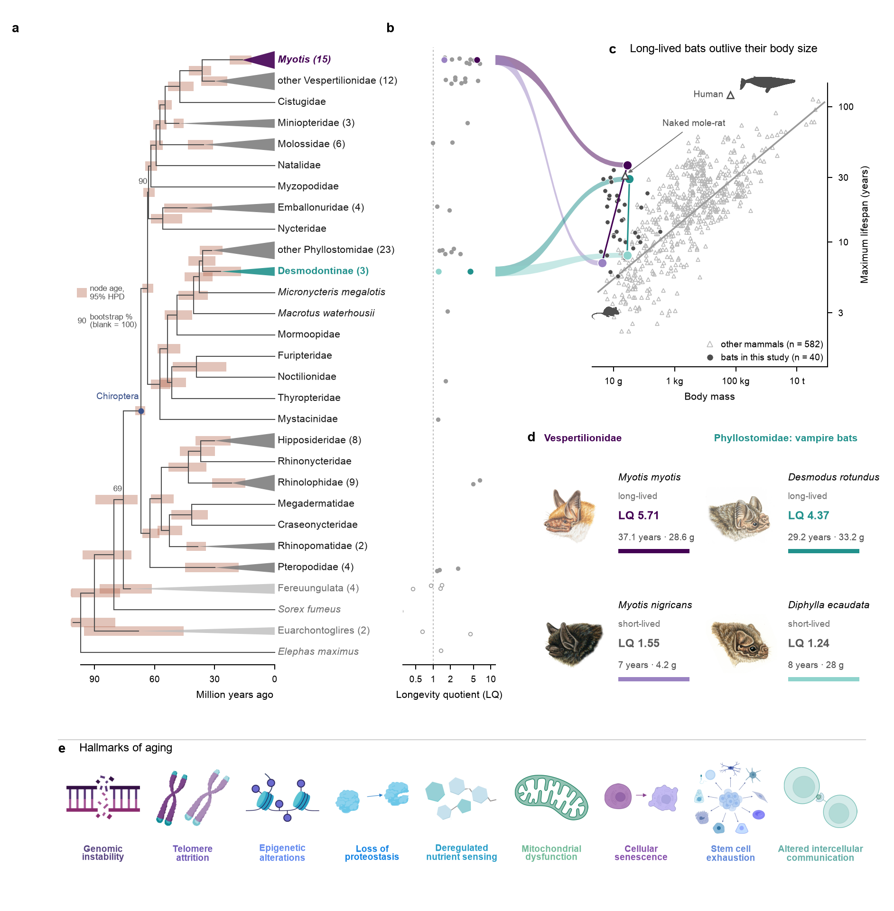

# Phylogeny and longevity-quotient figures

This folder builds the figures that set the four focal species in their phylogenetic and
life-history context. Both canvases are 180 x 190 mm.

- **`fig1_chronogram_180x190`** (script 03) is **Figure 1 of the manuscript**: the 30 species with
  genome assemblies, on the time-calibrated tree, over a geologic time scale.
- **`phylo_LQ_hallmarks_180x190`** (script 02) is the earlier 103-bat + 8-outgroup version,
  which carries node-age HPD bands and bootstrap support. It is kept for reference.

## Figure 1 (30 species, script 03)

| Panel | Content |
|---|---|
| A | Time-calibrated phylogeny of the 30 species with genome assemblies (23 bats, 7 non-bat mammals), drawn as a chronogram: branch lengths in Myr, root at the left, present at the right, over a geologic time scale in the official ICS/CGMW epoch colours |
| B | Longevity quotient (LQ) per species, log scale, aligned row-for-row with panel A; `n.d.` = no maximum-lifespan record |
| C | Maximum lifespan vs body mass for 89 bats (filled circles) and 582 other mammals (open triangles), with the non-flying-mammal expectation line used to compute LQ; ribbons link the four focal species to panel B |
| D | The two long/short-lived species pairs, each pair facing head to head |
| E | The nine hallmarks of aging, in López-Otín order |

Blue marks the longer-lived member of each pair and red the shorter-lived member; this figure
deliberately avoids the green/purple used elsewhere in the manuscript.

### Panel A: tree, dating and the time scale

- **Tree.** `data/forcedtop_longevity_timetree.tre` is a relaxed-clock dating run on a fixed
  topology, supplied by the collaborator. It is exactly ultrametric, with every tip at 97.5538 Ma.
  Node ages: root 97.55, Chiroptera 66.0, Yangochiroptera 57.1, Rhinolophoidea 38.0,
  Phyllostomidae 27.3, *Desmodus*|*Diphylla* 21.8 and the *Myotis* pair 11.5 Ma.
  The file carries no HPD annotations, so no date uncertainty is drawn.
- **Rooting.** The dated tree roots between (*Homo*, *Mus*) and the rest, so the seven non-bat
  mammals are paraphyletic and Chiroptera is sister to ((*Felis*, *Canis*), ((*Sus*, *Bos*), *Equus*)).
  The drawing follows the file's own rooting; the blue circle marks the crown Chiroptera node.
- **Topology cross-check.** `data/tree30.nwk` is the IQ-TREE supermatrix tree for the same 30 taxa.
  The script asserts the two differ at no more than 4 splits (RF = 4). Both disagreeing splits are
  among the non-bat outgroups — every bat clade is identical — and one of them is the supermatrix
  tree's only node below 100% bootstrap (71%, grouping *Equus* with *Homo* + *Mus*).
- **Geologic time scale.** Epoch colours and boundary ages are read from `data/ics_intervals.json`,
  which `scripts/00_export_ics_intervals.R` writes from the R `deeptime` package (2.4.0). Nothing is
  transcribed by hand. Each box takes the longest of its full name or ICS abbreviation that fits the
  drawn width, so the Pliocene, Pleistocene and Holocene are drawn but unlabelled at this scale.
  The Cretaceous box is clipped at the root (97.55 Ma), short of its true 143.1 Ma base.

Panel A was verified against the tree file end to end: all 29 internal nodes and all 58 branches are
drawn at the ages in the file (largest discrepancy 3.6e-15 Myr), and the drawn clade set equals the
file's clade set exactly.

| Panel | Content |
|---|---|
| a | T2 timetree from Morales et al. 2026 (*Nature* 658:141). Clades without focal species are collapsed to families. Bands show the 95% HPD of each node age, and numbers mark nodes with bootstrap support below 100%. |
| b | Longevity quotient (LQ) for each row (open circles = outgroups) |
| c | Body mass vs maximum lifespan: 582 non-flying mammals (open triangles), the 40 study bats with lifespan data (filled circles) and the line expected for non-flying mammals. Ribbons link the four focal species from panel b. |
| d | Focal species cards: *Myotis myotis* vs *M. nigricans*, and *Desmodus rotundus* vs *Diphylla ecaudata* |
| e | Hallmarks of aging banner, in López-Otín order |

## Node uncertainty (panel a)

Nothing was re-estimated: the support and dating values all come from the authors' own outputs.

- **Dating.** `T2_timetree.tre` is the mean of the 77 MCMCTree runs on coding sequences in
  `Divergence_Time_estimates/Caster_tree/coding_sequences` (all nodes agree within 0.03 Myr).
  Each band runs from the mean of the per-run lower 95% HPD bounds to the mean of the upper bounds. The median band width is about 12 Myr.
  - The CSV also gives the between-run spread of mean ages, with a median width of about 1.7 Myr. This measures how well the runs agree with each other, not how uncertain the dates are, so it is not what is plotted.
  - Bands that extend past the left edge of the plot are clipped and end in an arrowhead. This affects the root, whose HPD runs to about 124 Myr.
- **Topology.** Bootstrap values (`bs1`/1000) and quartet support (`q1`) are taken from the
  neutral-window CASTER tree `multiZhg38.concatNeutralWin_500_COV80.scored_U2.tre`, which has the same topology as T2.
  - 104 of the 108 nodes that can be scored have 100% bootstrap support. The two root nodes cannot be scored because that tree is unrooted.
  - The panel shows the two visible nodes below 100%: anc_Emballonuroidea_Vespertilionoidea (89.9%, q1 0.34) and anc_Scrotifera (68.8%).
  - The other two nodes below 100% fall inside collapsed clades: anc_N087 within *Myotis* (96.8%) and anc_N024 within *Hipposideros* (99.9%).

| Node | Age (Myr) | 95% HPD | Bootstrap | q1 |
|---|---|---|---|---|
| anc_Chiroptera | 66.8 | 64.7–69.6 | 100 | 0.73 |
| anc_Phyllostomidae | 40.4 | 33.5–48.0 | 100 | 0.91 |
| anc_Desmodontinae | 27.0 | 16.8–35.8 | 100 | 0.84 |
| anc_Myotis | 16.2 | 11.6–22.6 | 100 | 0.96 |

## Scripts

| Script | What it does |
|---|---|
| `scripts/01_extract_node_uncertainty.py` | Parses the MCMCTree `FigTree.tre` files and the CASTER support tree and writes `data/T2_node_support_age_uncertainty.csv`. It must be run where the Morales et al. outputs are unpacked; on Unity that is `/scratch4/workspace/tlama_smith_edu-project_longevity/dating/`. The command is in the script header. |
| `scripts/02_make_phylo_LQ_figure.py` | Builds the figure from `data/` and writes `figures/phylo_LQ_hallmarks_180x190.{pdf,png}`. It takes no arguments and is run from this folder. |
| `scripts/00_export_ics_intervals.R` | Writes `data/ics_intervals.json` from the R `deeptime` package: the ICS/CGMW epoch and period names, abbreviations, boundary ages and fill colours used by the panel A time scale. Needs R with `deeptime` and `jsonlite`. |
| `scripts/03_make_fig1_chronogram.py` | Builds Figure 1 and writes `figures/fig1_chronogram_180x190.{pdf,png}`. Takes no arguments and runs from any working directory; it resolves its inputs relative to its own location and stops with a list of missing files if an input is absent. |

`02_make_phylo_LQ_figure.py` was assembled from the interactive session that produced the
approved figure, and it reproduces that figure pixel for pixel.

`03_make_fig1_chronogram.py` likewise reproduces the approved Figure 1 pixel for pixel (verified:
0 of 3,311,770 pixels differ) and needs no font or style package beyond matplotlib.

Requirements: Python 3 with numpy, pandas, matplotlib, dendropy, pillow, scipy and openpyxl. The figure uses the Arial font.

## Data

| File | Content |
|---|---|
| `data/T2_timetree.labeled.nwk` | T2 timetree with a stable label on every internal node (anc_Chiroptera, anc_Myotis, …); ages in units of 100 Myr |
| `data/T2_internal_nodes_retention.tsv` | Internal nodes, their tips and their T2 ages |
| `data/T2_node_support_age_uncertainty.csv` | Output of script 01: per-node age, HPD, between-run spread, neutral-site age, bootstrap, q1 |
| `data/bat103_max_lifespan.xlsx` | Maximum lifespan, body mass and LQ for the 111 taxa, with sources (sheet `MLS_LQ_table`). LQ = MLS / 10^(0.537576 + 0.189234·log10 mass in g). |
| `data/data_lifespan_body_mammals.csv` | Lifespan and body mass for the 583-species mammal comparison set (ln units). The one bat in it, *Lasionycteris noctivagans*, is not in the study and is excluded. |
| `data/forcedtop_longevity_timetree.tre` | Dated tree for the 30 assembly species: ultrametric, branch lengths in Myr, named internal nodes. Input to panel A |
| `data/tree30.nwk` | IQ-TREE supermatrix tree for the same 30 taxa, with bootstrap support on internal nodes. Used only for the topology cross-check in script 03 |
| `data/species_names.tsv` | Assembly id to display name, and bat vs outgroup |
| `data/bat_lifespan_all_bats.csv` | Every bat with a maximum-lifespan record and a body mass, with the source of each value and a flag where sources disagree. Panel C plots the 89 complete rows |
| `data/ics_intervals.json` | Output of script 00: ICS/CGMW epoch and period boundaries and colours |
| `data/images/phylopic_whale_93d5c0be.png`, `phylopic_mouse_fe09db98.png` | PhyloPic silhouettes, both CC0: whale by Jonathan Pople (filed under *Cetotherium riabinini*); mouse by Ben Murrell (*Mus musculus*). The mouse marks the smallest mammal in the set, *Mus minutoides*. |

**Images not committed.** The bat paintings and the hallmarks graphic are artwork, so they
are not committed to this public repository. Place them in `data/images/` before running script 02:
`Myotis_myotis.jpg`, `Myotis_nigricans.jpg`, `Desmodus_rotundus.jpg`, `Diphylla_ecaudata.jpg`, `hallmarks_of_aging_v1.png`.
Scripts 02 and 03 use the same five files. Credits for the artwork go in the figure caption.

Note for script 03: the supplied paintings do not all face the same way (the two *Myotis* face left,
the two vampires face right), so the script mirrors each one only when its native direction points
away from the pair's meeting point. The directions are in the `FACE` dict.
